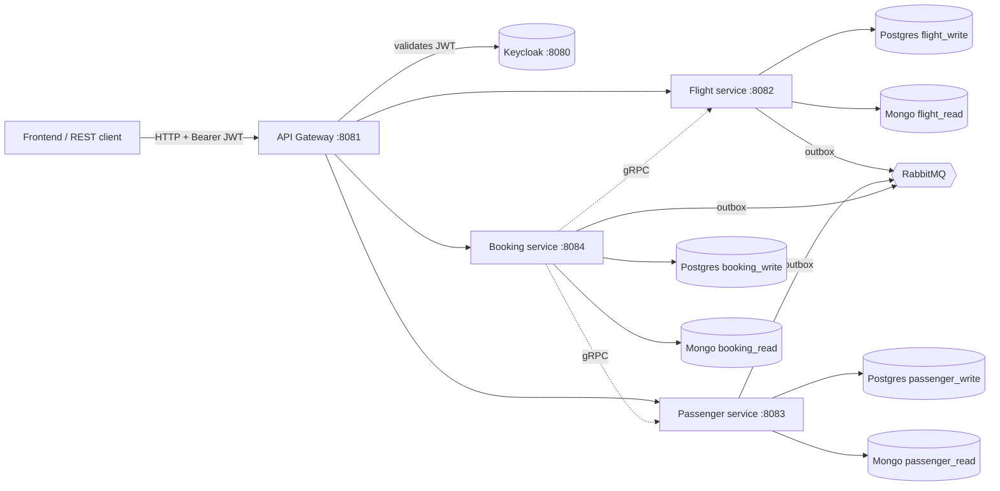
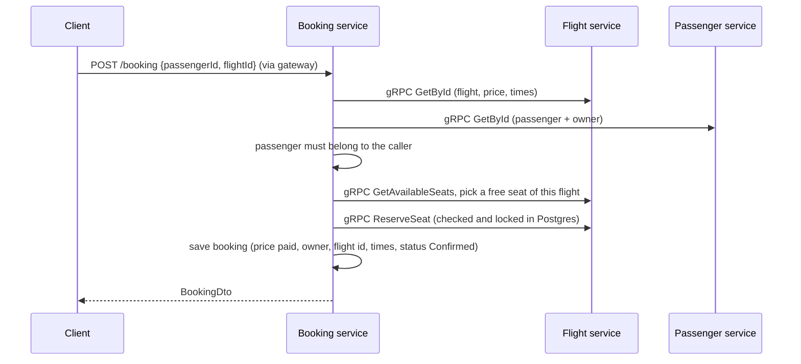
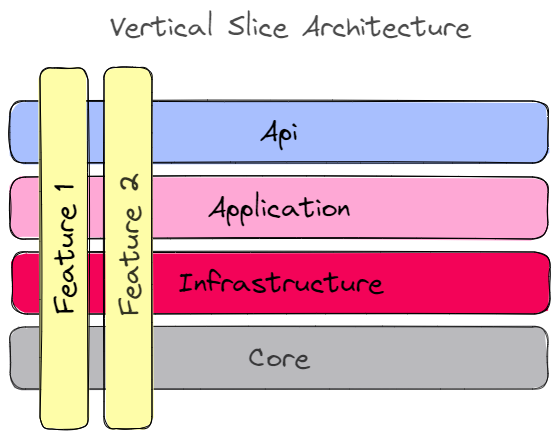

<div align="center" style="margin-bottom:20px">
  
</div>

> A flight-booking backend built as Java Spring Boot microservices: Vertical Slice Architecture, CQRS with a mediator pipeline, DDD aggregates, an outbox for events, gRPC between services, PostgreSQL for writes, MongoDB for reads, RabbitMQ, Keycloak (OIDC) and a Spring Cloud Gateway. Designed to sit behind a travel-booking website.

# Table of Contents

- [What you can do with it](#what-you-can-do-with-it)
- [Architecture](#architecture)
  - [Services and ports](#services-and-ports)
  - [Write side and read side](#write-side-and-read-side)
  - [How the services communicate](#how-the-services-communicate)
  - [Data model](#data-model)
  - [Authentication and authorization](#authentication-and-authorization)
  - [Key flows](#key-flows)
  - [Inside a service](#inside-a-service)
- [API summary](#api-summary)
- [How to run](#how-to-run)
- [Configuration](#configuration)
- [Testing](#testing)
- [Project structure](#project-structure)
- [Technologies](#technologies)
- [Recent changes](#recent-changes)
- [Known limitations](#known-limitations)
- [Contribution, license and credits](#contribution-license-and-credits)

## What you can do with it

- **Browse without an account:** search flights from one city to another (`Delhi` to `California` finds every airport of each), list airports and aircraft, see free seats.
- **Sign up and log in** (Keycloak): save travellers (passengers), book a flight for one of them, list your bookings, cancel a booking (the seat is freed).
- **Administer (role `ADMIN`):** create airports, aircraft and flights; creating a flight also creates its seats.

## Architecture



### Services and ports

| Component | Port | Responsibility |
| :--- | :--- | :--- |
| **API Gateway** (Spring Cloud Gateway) | `8081` | Single entry point. Validates JWTs, applies the CORS allow-list and the public-path rules, forwards `/api/v1/flight/**`, `/passenger/**`, `/booking/**` with the bearer token. |
| **Flight service** | `8082`, gRPC `9092` | Flights, seats, airports, aircraft, city-to-city search. |
| **Passenger service** | `8083`, gRPC `9093` | A user's saved travellers. |
| **Booking service** | `8084`, gRPC `9094` | Bookings. Asks Flight and Passenger over gRPC; owns no flight or passenger data. |
| **Keycloak** | `8080` | Identity provider. Realm `keycloak-realm`, imported from `deployments/configs/keycloak`. |
| **PostgreSQL 17** | `5432` | Write side, one database per service. |
| **MongoDB** | `27017` | Read side, one database per service. |
| **RabbitMQ** | `5672`, UI `15672` | Integration events. |
| Observability (optional) | various | OpenTelemetry collector, Jaeger/Zipkin/Tempo, Prometheus + Grafana, Loki, Elasticsearch + Kibana, cAdvisor (host port `8088`). Not needed to run the system. |

Every service owns its data: there are no cross-service database reads or foreign keys, only IDs. A booking therefore stores a snapshot of what it needs from the flight (number, times, price, seat, airports).

### Write side and read side

Each service keeps two copies of its data (CQRS):

- **Write side, PostgreSQL** (JPA, Flyway migrations in `src/main/resources/db/migration`): the source of truth. Every command saves here.
- **Read side, MongoDB**: shaped for the `GET` endpoints. A command's domain events are stored in an **outbox table** (`persist_messages`) in the same transaction; a background job (every second) turns them into internal commands that update Mongo, and publishes the integration events to RabbitMQ.

So **reads lag writes by about 1 to 3 seconds**. Clients should expect that after a write (use the `POST` response, or retry briefly).

### How the services communicate

| Style | Used for |
| :--- | :--- |
| **REST through the gateway** | Everything the frontend does. |
| **gRPC (synchronous)** | Booking asks Flight (`GetById`, `GetAvailableSeats`, `ReserveSeat`, `ReleaseSeat`) and Passenger (`GetById`, which also returns the owner's id). Contracts are `flight.proto` and `passenger.proto`; the producing and the consuming service keep identical copies. |
| **Domain event, then internal command** | Inside one service: Postgres change, then Mongo update (the projection). |
| **RabbitMQ integration events (outbox)** | `FlightCreated`, `SeatCreated`, `SeatReserved`, `SeatReleased`, `AirportCreated`, `AircraftCreated`, `PassengerCreated`, `PassengerUpdated`, `BookingCreated`, `BookingCancelled`... published through the outbox to one fanout exchange per service (`flight`, `passenger`, `booking`). Nothing consumes them yet (the passenger service has a listener that only logs). |

### Data model

PostgreSQL tables (write side). Every table also has `id`, audit columns, `version` (optimistic locking) and `is_deleted` (soft delete); there are no foreign keys, only IDs.

| Service | Table | Main columns |
| :--- | :--- | :--- |
| Flight | `flights` | `flight_number`, `departure_date`, `arrive_date`, `duration_minutes`, `flight_date`, `status`, `price`, `aircraft_id`, `departure_airport_id`, `arrive_airport_id` |
| Flight | `seats` | `seat_number`, `type` (window / middle / aisle), `seat_class`, `flight_id`. **One row = one physical seat on one flight.** `is_deleted = true` means *reserved*. Unique on (`flight_id`, `seat_number`). |
| Flight | `airports` | `name`, `code`, `address`, `city`, `region`, `country` |
| Flight | `aircrafts` | `name`, `model`, `manufacturing_year` |
| Passenger | `passengers` | `user_id` (owner = token `sub`), `name`, `passport_number`, `passenger_type`, `age`. Passport unique per owner. |
| Booking | `bookings` | `user_id` (owner), `status` (Confirmed / Cancelled), `name` (passenger name copy), `flight_id`, `flight_number`, `aircraft_id`, `departure_airport_id`, `arrive_airport_id`, `flight_date`, `departure_date`, `arrive_date`, `price` (price paid), `seat_number`, `description` |
| all | `persist_messages` | the outbox / inbox |

MongoDB holds the same entities as documents (`flights`, `seats`, `airports`, `aircrafts`, `passengers`, `bookings`) in `flight_read`, `passenger_read` and `booking_read`.

### Authentication and authorization

- **OIDC via Keycloak**, realm `keycloak-realm`. Services validate the JWT with Keycloak's JWKS endpoint; roles come from `realm_access.roles`.
- **Roles:** `USER` (every self-registered user gets it) and `ADMIN`.
- **Clients:** `travel-web` (public client for a browser frontend: authorization code flow with PKCE; redirect URIs `localhost:3000` and `localhost:5173`) and `booking-client-credentials` (secret `secret`, machine client whose token carries `ADMIN`; used by `booking.rest` and scripts).
- **Demo users (local use only):** `admin` / `admin123`, `traveller` / `traveller123`.

| Access | Endpoints |
| :--- | :--- |
| Public | `GET` flight list, flight by id, flight search, free seats, airports, aircraft |
| `USER` or `ADMIN` | passengers (create, list, get, update), bookings (create, list, get, cancel) |
| `ADMIN` | create/update/delete flights, create seats, reserve a seat, create airports and aircraft |

**Ownership:** passengers and bookings belong to the user who created them. Asking for someone else's returns `404` (not `403`) so ids cannot be probed; admins can access all. A booking can only use a passenger owned by the person booking (admins excepted). A missing role returns `403`, a missing/invalid token `401`.

### Key flows

**Book a flight** (`POST /api/v1/booking`)



**Cancel** (`DELETE /api/v1/booking/{id}`): owner or admin; the booking becomes `Cancelled` (kept in the history) and `ReleaseSeat` frees the seat in the same transaction, so a failure leaves both unchanged.

**Create a flight** (`POST /api/v1/flight`): the flight and `numberOfSeats` unreserved seats (`1A`, `1B` ... rows of `seatsPerRow`, default 6; window at both ends, aisle in the middle) are saved in one transaction; each seat raises the usual events that fill the read side.

**Search** (`GET /api/v1/flight/search?from=Delhi&to=California`): `from` and `to` are matched (partial text, ignoring case) against airport name, code, city, region and country. Only upcoming flights that are not `Canceled` or `Completed` are returned, each with both airports, the aircraft and `seatsLeft`; optional `date`, `sort` (`departure`, `price`, `duration`), `page`, `size`.

### Inside a service

- **Vertical slices (REPR):** each use case is a folder `<aggregate>/features/<usecase>/` with its controller, request DTO, command or query, validator, handler, domain event and the Mongo command/handler. Slices share only models and mappings.
  <div align="center"></div>
- **Mediator pipeline:** controllers send a command or query to the mediator; every request passes logging, then validation (Spring `Validator` beans), then a transaction that, on success, dispatches the collected domain events to the outbox.
- **DDD:** aggregates (`models`) are built from value objects (`valueobjects`) that validate themselves; JPA entities and Mongo documents are separate classes.
- **Errors** are RFC 7807 ProblemDetails (`400` validation / gRPC failure, `401`, `403`, `404`, `409`, `500`).
- **Shared code** lives in `src/buildingblocks` (mediator, outbox, Keycloak/security config, problem details, RabbitMQ, JPA/Mongo setup, test base classes). It is built first and consumed as a Maven dependency.

## API summary

All paths are through the gateway (`http://localhost:8081`). Times are ISO local date-times without a time zone, for example `2026-12-10T09:00:00`. Ready-made requests are in [booking.rest](./booking.rest); each service also serves Swagger UI at `/swagger-ui/index.html`.

| Method and path | Access | Notes |
| :--- | :--- | :--- |
| `GET /api/v1/flight/search` | public | `from`, `to` required; `date`, `sort`, `page`, `size` optional; returns `{ items, total, page, size }` |
| `GET /api/v1/flight`, `GET /api/v1/flight/{id}` | public | all flights / one flight |
| `GET /api/v1/flight/get-available-seats/{flightId}` | public | free seats |
| `GET /api/v1/flight/airport` (+`/{id}`) | public | `q` (text), `city` (exact) |
| `GET /api/v1/flight/aircraft` (+`/{id}`) | public | |
| `POST /api/v1/flight` | admin | flight data plus `numberOfSeats` (1-1000, required) and optional `seatsPerRow` |
| `PUT /api/v1/flight/{id}`, `DELETE /api/v1/flight/{id}` | admin | |
| `POST /api/v1/flight/seat`, `POST /api/v1/flight/reserve-seat` | admin | |
| `POST /api/v1/flight/airport` | admin | `name`, `code`, `address`, `city`, `country`, optional `region` |
| `POST /api/v1/flight/aircraft` | admin | `name`, `model`, `manufacturingYear` (1900 or later) |
| `POST /api/v1/passenger` | user | `name`, `passportNumber`, `passengerType` (`Male`/`Female`/`Baby`), `age` |
| `GET /api/v1/passenger`, `GET /api/v1/passenger/{id}` | user | mine / one (owner or admin) |
| `PUT /api/v1/passenger/{id}` | user | owner or admin |
| `POST /api/v1/booking` | user | `passengerId`, `flightId`, `description`; the service assigns a free seat |
| `GET /api/v1/booking`, `GET /api/v1/booking/{id}` | user | mine (newest trip first, cancelled included) / one |
| `DELETE /api/v1/booking/{id}` | user | cancel and free the seat |

## How to run

**Prerequisites:** Java 21, Docker (Desktop or Engine). Maven is bundled (`./mvnw`).

```bash
# 1. Infrastructure (only what the system needs; the full file also starts the monitoring stack)
docker compose -f deployments/docker-compose/docker-compose.infrastructure.yaml up -d rabbitmq postgres mongo keycloak

# 2. One-time: create the write databases (compose does not create them)
for db in flight_write passenger_write booking_write; do docker exec postgres psql -U postgres -c "CREATE DATABASE $db"; done

# 3. Build: the shared module first, then the services and the gateway
(cd src/buildingblocks && ./mvnw clean install)
for m in src/services/flight src/services/passenger src/services/booking src/apigateway; do (cd $m && ./mvnw clean install); done

# 4. Run each one (own terminal), from its folder
java -jar target/flight-1.0.0.jar          # likewise passenger-1.0.0.jar, booking-1.0.0.jar, apigateway-1.0.0.jar
```

- The first start applies the Flyway migrations and **seeds demo data** into empty databases: 6 airports (Lisbon, Sao Paulo, Delhi, Los Angeles, San Francisco, San Diego), 3 aircraft, 9 flights (8 upcoming, with 120-180 seats each, dated relative to the first start), and one test passenger without an owner (admin only). To get fresh demo dates, drop the flight databases (Postgres and Mongo) and restart the flight service.
- **Log in:** get a token from `http://localhost:8080/realms/keycloak-realm/protocol/openid-connect/token`. For scripts use the client-credentials client (see the `Authenticate` request in `booking.rest`); a browser frontend should use the `travel-web` client with the authorization code flow and PKCE. Keycloak admin console: `http://localhost:8080` (`admin` / `admin`).
- Missing tracing collector? The services log OpenTelemetry export errors when the optional monitoring stack is not running; they are harmless.

## Configuration

| Property | Where | Meaning |
| :--- | :--- | :--- |
| `app.cors.allowed-origins` | gateway | Comma-separated browser origins allowed to call the API (default `http://localhost:3000,http://localhost:5173`). Set your real site here before deploying. |
| `app.security.public-get-paths` | gateway **and** flight `application.yml` | GET path patterns that need no login. Keep both in sync. |
| `spring.rabbitmq.template.exchange` / `exchange-type` | each service | The service's integration-event exchange. |
| `spring.security.oauth2.resourceserver.jwt.jwk-set-uri` | each service and gateway | Keycloak JWKS URL. |

Defaults and demo credentials (`admin/admin123`, `traveller/traveller123`, client secret `secret`, Postgres `postgres/postgres`) are for local development only; change them before any real deployment.

## Testing

```bash
# unit tests of one module (no Docker needed)
./mvnw test -Dtest='**.unittest.**' -Dsurefire.failIfNoSpecifiedTests=false

# one test class
./mvnw test -Dtest=CreateBookingTests

# also the integration and end-to-end tests (flight service; they start Postgres, MongoDB and RabbitMQ with Testcontainers)
./mvnw test -DargLine="-Dapi.version=1.44"
```

Docker Engine 29 and newer rejects the old Docker API version used by Testcontainers 1.20.4, so the Docker-based tests need `-Dapi.version=1.44` (or an upgrade of Testcontainers). At the time of writing there are 101 unit tests (buildingblocks 9, flight 52, passenger 16, booking 19, gateway 5) and 2 Docker-based tests, all passing. The full flow was also verified by calling the running system through the gateway with real Keycloak tokens.

## Project structure

```text
.
├── booking.rest                      sample requests (VS Code REST Client)
├── deployments
│   ├── docker-compose                infrastructure compose file
│   └── configs                       keycloak realm, prometheus, grafana, loki, tempo, otel collector
└── src
    ├── apigateway                    Spring Cloud Gateway (security, CORS, routing)
    ├── buildingblocks                shared library: mediator, outbox, security, errors, rabbitmq, test base
    └── services
        ├── flight                    flights, seats, airports, aircraft, search   (proto, migrations, seeds, grpcserver)
        ├── passenger                 travellers                                   (proto, migrations, grpcserver)
        └── booking                   bookings                                     (proto copies, migrations, grpcclient)
```

## Technologies

Spring Boot 3.4 (MVC) and Spring Cloud Gateway · Spring Security (OAuth2 resource server) with Keycloak · Spring Data JPA (PostgreSQL) with Flyway and QueryDSL · Spring Data MongoDB · Spring AMQP (RabbitMQ) · gRPC (grpc-spring) and Protocol Buffers · springdoc OpenAPI · OpenTelemetry · Lombok · UUID Creator · JUnit 5, Mockito, AssertJ and Testcontainers.

## Recent changes

This version turned the sample into a backend a travel website can use. Summary of what was added or fixed:

- **Auth:** public browsing; `USER` / `ADMIN` roles; Keycloak in docker-compose with an importable realm (sign-up, a PKCE client for browsers, a machine client); gateway CORS allow-list.
- **Flights:** `GET /flight/search` (city-to-city, contains matching, upcoming only, seats left, sort, paging); airports with city, region and country; airport and aircraft read endpoints; `POST /flight` creates the flight's seats; demo flights and seats in the seed data.
- **Seats and bookings:** the booking price is the flight's price (was hard-coded to 1); seats are unique per flight and must belong to an existing flight; a booking only uses seats of its own flight; bookings have an owner, status, flight id and departure/arrival times; list, get and cancel bookings (cancel frees the seat through a new gRPC `ReleaseSeat`).
- **Passengers:** owned by their creator, `GET /passenger` (mine), `PUT /passenger/{id}`, passport unique per owner, a clean `404` instead of a `500`; booking requires the booker to own the passenger.
- **Fixes found by running the whole system:** pinned Postgres 17 (latest no longer starts with the compose mount); Keycloak realm file naming and the default `USER` role; the event dispatcher scanned the whole classpath on every request (added about 0.8 s each, 17 s to create a 20-seat flight); the outbox waited 5 s per event for a reply that never came (new data took minutes to show up) and published to exchanges that did not exist; missing role now returns `403` instead of `500`; creating an airport or an aircraft always failed with `500`; the aircraft year check was inverted; the create-passenger JSON key was `PassportNumber` (now `passportNumber`).
- **Docs and tests:** this README, 101 unit tests plus 2 Docker-based tests, and `booking.rest` samples for every endpoint.

## Known limitations

- **Back-to-back bookings on one flight can fail for 1-3 seconds.** The booking service picks the first free seat from the read copy, which is a moment behind; retry after a short pause. A fix (pick among free seats and retry) is planned. Also, if saving a booking fails after its seat was reserved, that seat stays reserved.
- **No seat choice:** the service assigns a free seat.
- **No time zones:** all times are local as stored; durations are not recalculated.
- One price per flight, no currency, Economy seats only; no payments, airlines, connecting flights or multi-passenger bookings; saved travellers cannot be deleted.
- Search uses partial-text matching, so short words match many places (`san` matches San Diego, San Francisco and Sao Paulo).
- Passengers and bookings created before ownership existed have no owner (admin only, and such bookings cannot be cancelled); seeds only run on empty databases.
- RabbitMQ events are published but not consumed (the passenger service's `FlightUpdatedListener` listens on a different exchange and only logs).
- Domain events are kept in a static list shared by all requests, so two commands running at the same moment could mix events.

## Contribution, license and credits

Contributions are welcome: please follow the [contribution guideline](./CONTRIBUTION.md). Licensed under the terms in [LICENSE](./LICENSE).

Project references and credits (from the original sample):

- [https://github.com/jbogard/ContosoUniversityDotNetCore-Pages](https://github.com/jbogard/ContosoUniversityDotNetCore-Pages)
- [https://github.com/kgrzybek/modular-monolith-with-ddd](https://github.com/kgrzybek/modular-monolith-with-ddd)
- [https://github.com/oskardudycz/cqrs-is-simpler-with-java](https://github.com/oskardudycz/cqrs-is-simpler-with-java)
